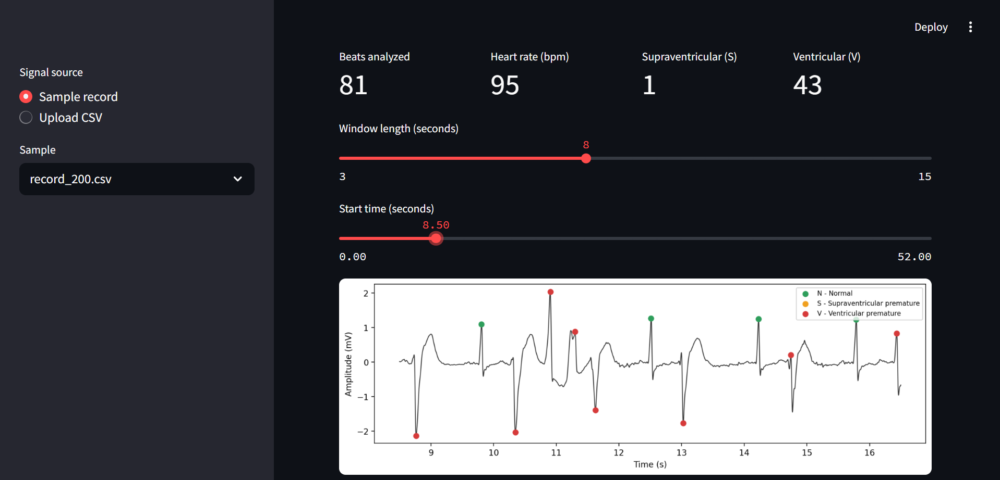

# ECG Arrhythmia Classification

Classifies individual heartbeats from single-lead ECG signals as **Normal (N)**, **Supraventricular premature (S)** or **Ventricular premature (V)** using machine learning, and includes a Streamlit app that analyzes a raw ECG signal end to end.



## Highlights

- Full pipeline from **raw signal**: filtering, R-peak detection, beat segmentation, feature extraction, classification
- **Inter-patient evaluation**: train and test patients never overlap (the realistic and harder setting)
- Class imbalance handled with sample weights and per-class decision weights tuned by patient-grouped cross-validation
- Honest reporting of failures (see Limitations)

## Dataset

[MIT-BIH Arrhythmia Database](https://physionet.org/content/mitdb/1.0.0/) (PhysioNet): 48 half-hour two-lead recordings at 360 Hz with beat-by-beat expert annotations. Only the first lead (MLII) is used.

- Annotations are grouped into the standard AAMI classes (N, S, V, F, Q).
- The four paced records (102, 104, 107, 217) are excluded, following AAMI recommendations.
- Patient-wise split from de Chazal et al. (2004): 22 records for training (DS1), 22 different records for testing (DS2).
- The Q class has only 15 beats after excluding paced records, so it is dropped.

The data is not stored in this repo; notebook 01 downloads it from PhysioNet.

## Method

1. **Preprocessing**: Butterworth band-pass filter (0.5 to 40 Hz, zero-phase), then each beat is cut as 90 samples before and 110 samples after the R-peak.
2. **Features (57)**: R-R intervals (previous, next, ratios, ratio to the patient median) and beat morphology (amplitudes, QRS width estimate, energy, area, skewness, kurtosis, and a 40-point normalized beat shape).
3. **Model**: Random Forest (200 trees) with balanced sample weights. Per-class decision weights are tuned on out-of-fold predictions from 5-fold patient-grouped cross-validation, using the training patients only.
4. **Inference pipeline** (`src/pipeline.py`): resampling to 360 Hz, filtering, R-peak detection with the XQRS algorithm from `wfdb`, then the same features and model.

## Results (22 unseen test patients)

| Class | Precision | Recall | F1 | Beats |
|---|---|---|---|---|
| N (normal) | 0.956 | 0.971 | 0.963 | 44,218 |
| S (supraventricular premature) | 0.181 | 0.161 | 0.170 | 1,836 |
| V (ventricular premature) | 0.946 | 0.918 | 0.932 | 3,219 |
| F (fusion) | not predicted | | | 388 |

Overall accuracy 0.930, macro F1 over N, S and V: 0.689.

End-to-end check on raw signals (own R-peak detection, no annotations used): the detector finds almost all annotated beats with a median offset of 0 samples, and for example record 200 reaches 96% accuracy.

## Limitations

- **S beats are weak** (F1 0.17). They look very similar to normal beats and differ mostly in timing, which the current features capture only partly.
- **F (fusion) beats are not predicted.** Only 414 training beats from a few patients. With the F class weight tuned in cross-validation, the model reached recall 0.82 but precision 0.055 on the test patients (macro F1 over four classes: 0.526), producing thousands of false alarms. I then removed the F class from the output. This decision was made after looking at the test results.
- Local rhythm context features (average of the previous 10 R-R intervals) did not improve cross-validated performance (0.510 vs 0.522) and were not used.
- Evaluated on one database, one lead only. Not validated on other devices or populations.
- **This is an educational project, not a medical device.**

## Run the app

```bash
pip install -r requirements.txt
streamlit run app/streamlit_app.py
```

Pick a demo sample or upload a CSV with one column of ECG samples (mV) and set the sampling rate.

## Reproduce

Run the notebooks in order:

| Notebook | Purpose |
|---|---|
| `01_load_and_explore` | Download MIT-BIH, explore signals and labels |
| `02_preprocessing` | Filtering, AAMI classes, beat segmentation, patient split |
| `03_features_and_model` | Baseline features and Random Forest |
| `04_improve_model` | Patient-grouped CV, model comparison, class weight tuning |
| `05_save_model` | Train and save the final model |
| `06_test_pipeline` | End-to-end test on raw signals |
| `07_make_samples` | Create demo samples for the app |

## Project structure

```
app/            Streamlit app and demo samples
models/         Trained model
notebooks/      Step-by-step notebooks
src/            Feature extraction and inference pipeline
docs/           README images
```

## References

- Moody GB, Mark RG. The impact of the MIT-BIH Arrhythmia Database. IEEE Eng Med Biol 20(3):45-50, 2001.
- Goldberger AL et al. PhysioBank, PhysioToolkit, and PhysioNet. Circulation 101(23):e215-e220, 2000.
- de Chazal P, O'Dwyer M, Reilly RB. Automatic classification of heartbeats using ECG morphology and heartbeat interval features. IEEE Trans Biomed Eng 51(7):1196-1206, 2004.