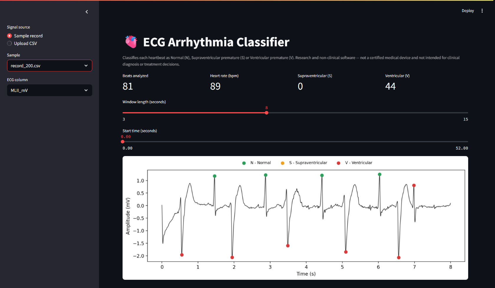

# ECG Arrhythmia Classification

Classifies individual heartbeats from single-lead ECG signals as **Normal (N)**, **Supraventricular premature (S)** or **Ventricular premature (V)** using machine learning. Includes a Streamlit demo and a **fully offline Android app**.



**[Download the Android app (APK)](https://github.com/TahaAbbasi211/ecg-arrhythmia-classification/releases/latest)**: runs fully offline, no data leaves the phone.

## Highlights

- Full pipeline from the **raw signal**: filtering, R-peak detection, beat segmentation, feature extraction, classification
- **Inter-patient evaluation**: train and test patients never overlap (the realistic and harder setting)
- Class imbalance handled with sample weights and per-class decision weights tuned by patient-grouped cross-validation
- The inference code was rewritten with plain loops (`src/portable.py`) and ported to **Dart**; the Android app reproduces the Python reference on golden test vectors
- Honest reporting of failures (see Limitations)

## Dataset

[MIT-BIH Arrhythmia Database](https://physionet.org/content/mitdb/1.0.0/) (PhysioNet): 48 half-hour two-lead recordings at 360 Hz with beat-by-beat expert annotations. Only the first lead (MLII) is used.

- Annotations are grouped into the standard AAMI classes (N, S, V, F, Q).
- The four paced records (102, 104, 107, 217) are excluded, following AAMI recommendations.
- Patient-wise split from de Chazal et al. (2004): 22 records for training (DS1), 22 different records for testing (DS2).
- The Q class has only 15 beats after excluding paced records, so it is dropped.

The data is not stored in this repo; notebook 01 downloads it from PhysioNet.

## Method

1. **Preprocessing**: Butterworth band-pass filter (0.5 to 40 Hz, zero-phase), then each beat is cut as 90 samples before and 110 samples after the R-peak.
2. **Features (57)**: R-R intervals (previous, next, ratios, ratio to the recording median) and beat morphology (amplitudes, QRS width estimate, energy, area, skewness, kurtosis, and a 40-point normalized beat shape).
3. **Model**: Random Forest with 50 trees (minimum leaf size 5) and balanced sample weights. Per-class decision weights (N 1, S 2, V 1, F 0) were tuned on out-of-fold predictions from 5-fold patient-grouped cross-validation, using the training patients only. The forest has 36k nodes (1.3 MB as JSON). A 200-tree forest (198k nodes) performed the same (macro F1 over N, S, V: 0.689 vs 0.690 on annotation-aligned test beats).
4. **Inference pipeline** (`src/portable.py`): linear resampling to 360 Hz, a zero-phase Butterworth band-pass built from plain biquad loops, a Pan-Tompkins style R-peak detector (5-15 Hz band-pass, derivative, squaring, moving-window integration, adaptive thresholds with search-back), then the same beat features and forest. It uses no scipy, wfdb or scikit-learn at inference time, so it could be ported to Dart.

## Results (22 unseen test patients, end to end from the raw signal)

R-peak detection finds 99.7% of the annotated beats (positive predictivity 99.8%). The median offset to the expert annotation is 0 samples (5th/95th percentile: -1/+1).

| Class | Precision | Recall | F1 | Beats |
|---|---|---|---|---|
| N (normal) | 0.958 | 0.972 | 0.965 | 44,167 |
| S (supraventricular premature) | 0.201 | 0.158 | 0.177 | 1,825 |
| V (ventricular premature) | 0.901 | 0.945 | 0.923 | 3,183 |
| F (fusion) | not predicted | | | 383 |

Overall accuracy 0.933, macro F1 over N, S and V: 0.688.

## Android app

- Fully offline: no internet permission, all processing and the model run on the phone. English and Persian (with right-to-left layout), switchable in the app.
- Pure Dart port of the pipeline in `mobile/lib/ecg`. Correctness is checked with golden test vectors generated from the Python reference (`export/test_vectors.json`): the filter, R-peak detector, features, forest and the end-to-end result are each compared with the Python output. The resampler is additionally pinned to a shared fixture (`export/resample_parity.json`) that both `pytest` and `flutter test` read. 51 Flutter tests in total.
- A 30-minute recording (650,000 samples) is analyzed in under a second on a PC.
- Build instructions and signing: see `mobile/README.md` and `mobile/android/SIGNING.md`.

## Limitations

- **S beats are weak** (F1 0.18). They look very similar to normal beats and differ mostly in timing, which the current features capture only partly.
- **F (fusion) beats are not predicted.** Only 414 training beats from a few patients. With the F class weight tuned in cross-validation, the earlier 200-tree model reached recall 0.82 but precision 0.055 on the test patients (macro F1 over four classes: 0.526), producing thousands of false alarms. I then removed the F class from the output. This decision was made after looking at the test results.
- **The test patients influenced one more decision.** The smallest forest allowed by my first selection rule (30 trees) scored macro F1 0.671 on the test patients, mostly because of V precision. I then changed the rule to "best cross-validation score under a 1 MB size budget", which selected the 50-tree forest.
- Local rhythm context features (average of the previous 10 R-R intervals) did not improve cross-validated performance (0.510 vs 0.522) and were not used.
- Evaluated on one database, one lead only. Not validated on other devices or populations.

## v2.1 (hardening release)

The model did not change: `models/ecg_rf_small.joblib` (50 trees) and its 57 features are the same file as v2.0.0, and the DS2 results below were re-measured end to end after the changes. What changed is everything around the model:

- **Input handling (both apps)**: CSV files may have one column or `(time, ecg)` (the time axis is detected by its header or by being evenly increasing and never used as the ECG), `#` and `//` comment lines, a BOM, `;` or tab separators, and broken or non-UTF-8 text now shows an error instead of crashing.
- **Units and polarity**: an input unit selector (mV, V, uV) and a manual invert switch. After filtering, a spread of `p99 - p1` below 0.05 or above 20 suggests the wrong unit; the app says so and offers a one-click conversion, but never converts on its own.
- **Missing samples**: scattered NaN/Inf values are interpolated, while a file with more than 5% bad samples or a gap longer than 0.5 s is rejected with a clear message instead of producing nonsense.
- **Resampling**: inputs above 360 Hz are low-pass filtered at 150 Hz before linear resampling, so high-frequency content cannot alias into the ECG band and invent beats. The Dart and Python implementations are checked against one shared fixture at 180, 250 and 500 Hz.
- **R-peak detector**: the adaptive threshold is now initialised from the median of 2 s block maxima and a median noise level, which removes the cold-start behaviour on recordings that begin with a large beat.
- **Plotting (Android)**: the 60 s trace is drawn as a viewport-sized canvas over a scrollable spacer with Min-Max decimation, so a recording is no longer squeezed into the screen width and scrolling stays left-to-right in Persian.
- **Packaging**: pinned `requirements.txt`/`requirements-dev.txt`, a `tests/` suite for the Python side, `scripts/evaluate_ds2.py` for the DS2 numbers, and local Android signing instructions that keep installed copies updatable.

## Run the Streamlit app

```bash
pip install -r requirements.txt
streamlit run app/streamlit_app.py
```

Pick a demo sample or upload a CSV/TXT file. Accepted input:

- one column of ECG samples, or two columns `(time, ecg)` - the time column is detected and ignored;
- a header line with names (a text first line is treated as the header);
- `,`, `;` or tab separators, `#` or `//` comment lines, and a UTF-8 BOM.

Set the sampling rate, choose the input unit (mV by default) and invert the polarity if the ECG was recorded upside down. The app warns when the amplitude looks like the wrong unit.

## Tests

```bash
pip install -r requirements-dev.txt
pytest -q                 # parsing, DSP, pipeline, app smoke test (48 tests)
cd mobile
flutter analyze
flutter test              # portable reference, plot, screens, localization (51 tests)
```

`python scripts/evaluate_ds2.py` reproduces the DS2 numbers below with the portable pipeline (`--scipy` switches to the wfdb/XQRS reference). `python scripts/export_test_vectors.py` regenerates the golden vectors, and `python scripts/export_resample_parity.py` the resampling fixture.

## Reproduce

Run the notebooks in order:

| Notebook | Purpose |
|---|---|
| `01_load_and_explore` | Download MIT-BIH, explore signals and labels |
| `02_preprocessing` | Filtering, AAMI classes, beat segmentation, patient split |
| `03_features_and_model` | Baseline features and Random Forest |
| `04_improve_model` | Patient-grouped CV, model comparison, class weight tuning |
| `05_save_model` | Train and save the first (200-tree) model |
| `06_test_pipeline` | End-to-end test on raw signals with the XQRS detector |
| `07_make_samples` | Create demo samples for the app |
| `08_portable_pipeline` | Evaluate the portable pipeline on all test patients |
| `09_shrink_model` | Find a small forest with the same performance |
| `10_export_and_verify` | Export the model to JSON, verify the simple implementation and create golden test vectors |

## Project structure

```
app/            Streamlit app, shared signal-file parsing and demo samples
export/         Exported model (JSON), filter config, golden vectors, resampling fixture
mobile/         Offline Flutter (Android) app
models/         Trained models (final: ecg_rf_small.joblib)
notebooks/      Step-by-step notebooks
scripts/        DS2 evaluation and golden-vector/parity export
src/            Features, inference pipeline and portable reference implementation
tests/          pytest suite (parsing, DSP, pipeline, golden vectors)
docs/           README images
```

## References

- Moody GB, Mark RG. The impact of the MIT-BIH Arrhythmia Database. IEEE Eng Med Biol 20(3):45-50, 2001.
- Goldberger AL et al. PhysioBank, PhysioToolkit, and PhysioNet. Circulation 101(23):e215-e220, 2000.
- de Chazal P, O'Dwyer M, Reilly RB. Automatic classification of heartbeats using ECG morphology and heartbeat interval features. IEEE Trans Biomed Eng 51(7):1196-1206, 2004.

## License

MIT - see [LICENSE](LICENSE).