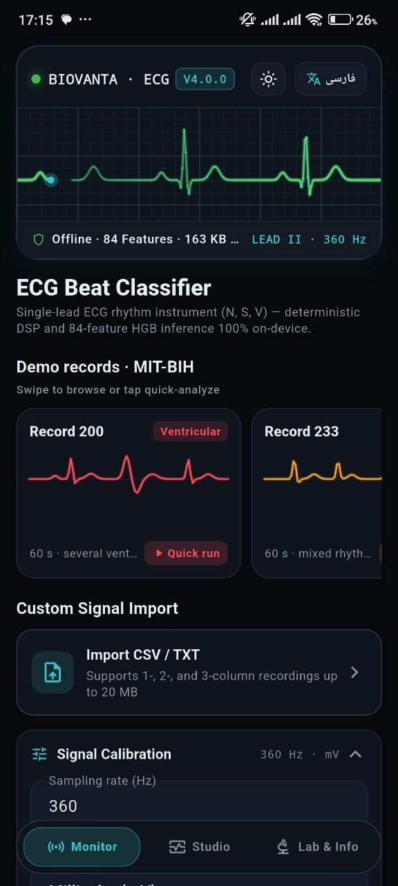
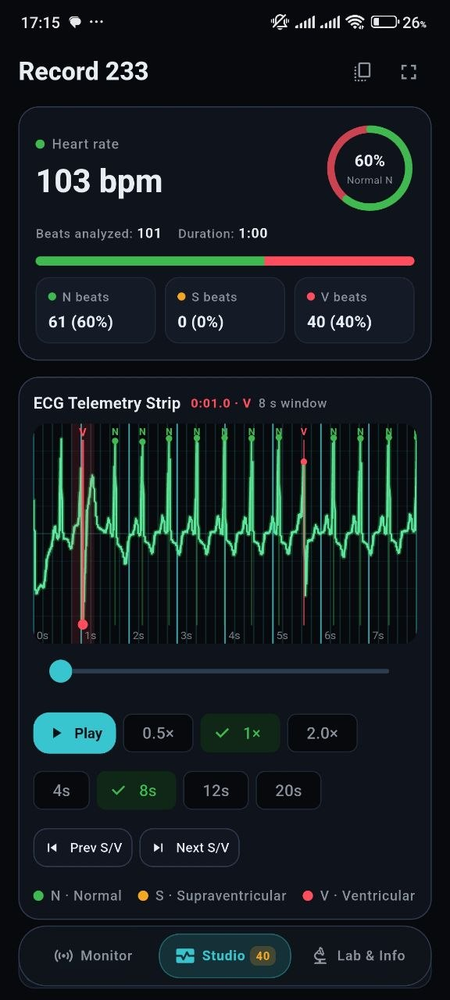

# ECG Beat Classifier (Android) - V4.0.0

Offline Flutter app that classifies heartbeats of a single-lead ECG as **N** (normal),
**S** (supraventricular premature) or **V** (ventricular premature).

> **Disclaimer:** Research and non-clinical software — not a certified medical device and not intended for clinical diagnosis or treatment decisions.

<p align="center">
  
  &nbsp;&nbsp;&nbsp;
  
</p>

**Features:**
- **Full Persian (Farsi) & English localization:** Native Right-to-Left (RTL) support, full medical and technical Persian terminology, and an instant in-app language switcher (`FA` / `EN`).
- Automatic locale detection (starts in Persian if device language is Persian).
- Pure on-device offline inference (no internet permission required).

**New in V4.0.0 (`4.0.0+5`):**
- **BioVanta Obsidian Dark & Clinical ECG Paper Light UI (`Monitor`, `Studio`, `Lab & Info`):** Complete 3-tab redesign with custom adaptive BioVanta Obsidian QRS launcher icon, tabular readouts (`FontFeature.tabularFigures()`), and instant 1-tap theme (`Dark` / `Light` / `System`) & language (`EN` / `FA` RTL) switching.
- **Live ECG Cockpit & Fullscreen Monitor:** Clinical millimeter paper grid (`40 ms` / `200 ms` / `1 s`), live phosphor sweep playback (`0.5×` / `1×` / `2×`) synchronized with beat selection, `Prev/Next S/V` stepping, and distraction-free fullscreen route.
- **200-Sample Beat X-Ray Morphology Microscope:** Displays `-250 ms` to `+305 ms` beat waveform overlaid with the patient recording's median-template ghost (`P`/`QRS`/`T` bands), R-R timing cards, and normalized decision `score` + raw `p` breakdown.
- **Interactive R-R Rhythm Analytics:** Beat-to-beat **R-R Tachogram** and **Poincaré HRV scatter plot** (`RR[n]` vs `RR[n+1]`) with tap-to-jump navigation to any beat.
- **R8 Shrinking & Expanded Verification:** Enables `isMinifyEnabled` + `isShrinkResources` (`proguard-rules.pro`), passes `flutter analyze` with zero issues and **65 Flutter tests**, all powered by the **frozen `v3.1` offline engine** (`163 KB` HGB, 84 scale-invariant features, IEEE-754 `float64` parity).

**Foundation from V3.1.0 (`3.1.0+4` — frozen scientific engine):**
- **Scale-invariant `v3.1` engine:** Upgraded from the `1.275 MB` 50-tree Random Forest (`ecg_forest.json`, removed from assets) and 57 features to a **`163 KB` `HistGradientBoosting` model (`ecg_model_v3.json`)** over **84 scale-invariant features** (`features_v3.dart`), reducing asset size by **>1.1 MB**.
- **True `float64` HGB inference (`hgb_model.dart`):** Unrounded `float64` split thresholds with an `isFinite` guard across all 84 features (no `Float32List` rounding), matching `scikit-learn` within `2.25e-6` (`0` label flips across `9,933` `DS2` beats).
- **Scale invariance across Volts, mV, and µV:** Beats are median-centered and normalized by `rec_scale`, so `0.001×`, `1×`, and `1000×` recordings yield identical beat predictions (unit selection remains useful for an accurate `mV` vertical axis on the plot).
- **Normalized `score` display:** Abnormal (`S`/`V`) beat rows display `score` = `(proba * decision_weights) / sum(proba * decision_weights)` (uncalibrated relative model score) instead of inflated raw unweighted probabilities.
- **Updated About metrics & limitations:** Displays `DS2` end-to-end F1s (`N 0.972`, `V 0.952`, `S 0.179`, `Macro F1 0.701`) and explicitly explains the sustained ectopic atrial rhythm limitation (e.g., MIT-BIH record `232`) in both English and Persian.

Everything runs on the device: filtering, Pan-Tompkins R-peak detection, 84 v3 features, and the 65-iteration (3-class) gradient-boosted tree ensemble are pure Dart. There is no network code, no analytics and no ML plugin, and the release manifest has no `INTERNET` permission.

## Requirements

- Flutter 3.47 or newer (Dart 3.13+)
- Android SDK with platform 36 and build-tools 35.0.0
- Android NDK 28.2.13676358 (pinned in `android/app/build.gradle.kts`)
- JDK 21

Check the toolchain first:

```bash
flutter doctor -v
```

## Build notes

The Android shell is pinned rather than left on the newest defaults, because
Flutter 3.47's Gradle plugin does not work with the newest Android Gradle Plugin:

- **AGP 8.11.1** in `android/settings.gradle.kts`. AGP 9 enables `android.newDsl`,
  which the Flutter Gradle plugin cannot read yet.
- **NDK 28.2.13676358** pinned explicitly. Without the pin AGP 8.11.1 asks for
  NDK 27, while Flutter provisions 28.
- **`kotlin.incremental=false`** in `android/gradle.properties`. The Kotlin
  incremental cache fails to close when the build directory is locked or
  sandboxed; disabling it only costs build time, not APK quality.
- If `dl.google.com` is unreachable on your network, the Gradle build cannot
  resolve AGP or AndroidX. An init script at `~/.gradle/init.d/mirrors.gradle`
  that adds a Google Maven mirror fixes it without touching this repo.

## Build

```bash
cd mobile
flutter pub get
flutter analyze
flutter test
flutter build apk --release --split-per-abi
```

Signing: release builds require `android/key.properties` pointing to a dedicated release
keystore (`release.jks`). Without it, Gradle fails closed unless `-PallowDebugRelease=true`
is explicitly passed for a local debug-signed release build (see `android/SIGNING.md`).

Install one on a connected device:

```bash
adb install -r build/app/outputs/flutter-apk/app-arm64-v8a-release.apk
```

The release APK requests no permissions at all beyond Flutter's internal
`DYNAMIC_RECEIVER_NOT_EXPORTED_PERMISSION`; there is no `INTERNET` permission.

## Tests

`test/portable_test.dart` replays the golden vectors in `../export/test_vectors.json`,
produced by the Python reference (`src/portable.py`). It checks, for each of the three
recordings:

| Check | Tolerance |
|---|---|
| `filtFilt(raw)` vs `filtered` | max abs diff ≤ 1e-6 |
| `detectRPeaks(filtered)` vs `detected_peaks` | exact |
| `extractRecordingFeaturesV3` (84 features) vs `features` | max abs diff < 1e-10 |
| `HgbModel.predictProba` & `effectiveScores` | abs diff ≤ 1e-6 |
| `analyze(raw, 360)` vs `used_peaks`, `pred`, `proba`, `scores` | exact / exact / 1e-6 |
| Scale invariance (`0.001×`, `1×`, `1000×` on `record_200_100s`) | exact peaks/pred, proba/scores ≤ 1e-6 |

The test file reads the vectors from the repo, so `export/test_vectors.json` is
deliberately **not** bundled into the app.

`test/portable_test.dart` also replays `../export/resample_parity.json` (180, 250, 500 Hz within `1e-8`), guards `detectRPeaks` on `< 5` samples, and verifies `HgbModel.predictProba` throws `ArgumentError` on `NaN`/`Inf` or wrong feature length.

Four more suites cover the app itself:

- `test/ui_test.dart` — CSV parser, 3-tab `InstrumentShell`, Dark/Light theme switching, home/about screens (`V4.0.0`, `DS2` & `SVDB` metrics, sustained atrial rhythm limitation), rate validation, unit/polarity controls, 320 px responsiveness, plot geometry, and Min-Max envelope.
- `test/result_screen_test.dart` — Telemetry HUD, plot, live sweep playback, Beat X-Ray, R-R Tachogram/Poincaré, window slider, live language switch, S/V beat rows (`score = ...`, default weighted `effectiveScores`), time formatting, and 320 px narrow-phone layout.
- `test/persian_test.dart` — every screen in Persian with RTL checks and locale cleanup.
- `test/isolate_test.dart` — isolate execution end to end: `record_200.csv` gives 81 beats (`37 N, 0 S, 44 V`) at `89.3 bpm`, and a flat signal reports no beats.

Measured performance: `analyze()` on a 30.1-minute signal (`650,000` samples, `2,465` beats) finishes in **`~3.3 s`** in the Dart test VM and runs in a background isolate on the phone.

## Layout

```
lib/
  ecg/            pure Dart, no Flutter imports
    constants.dart    FS, PRE/POST, R, 84 feature constants, v3.1 weights
    stats.dart        numpy-compatible median / percentile / argmax / argmin
    filter.dart       sosFilt, filtFilt (odd-extension padding, padlen 720)
    resample.dart     sanitizeSignal, anti-alias low-pass, resampleLinear to 360 Hz
    rpeaks.dart       detectRPeaks (Pan-Tompkins style, n < 5 guard)
    features_v3.dart  extractRecordingFeaturesV3 (84 scale-invariant + template + PT features)
    hgb_model.dart    HgbModel.fromJson, predictProba (pure float64, isFinite guard), effectiveScores
    analyze.dart      EcgConfig, EcgAnalyzer.analyze
  data/           asset loading, signal parser, units, isolate worker
  l10n/           English and Persian strings
  ui/             3-tab shell, view-model, home, result, about screens, plot, widgets (X-Ray, R-R charts, fullscreen), theme
assets/
  ecg_config.json    filter coefficients + v3.1 schema/decision weights
  ecg_model_v3.json  compact 163 KB exported HistGradientBoosting model
  samples/*.csv      three 60 s demo records at 360 Hz
```

## Porting notes

The Dart code mirrors `src/portable.py` and `src/features_v3.py` line for line:

- `np.median` with an even count is the mean of the two middle values.
- `argmax` / `argmin` / `max(..., key=...)` return the **first** index on ties.
- `filtfilt` odd extension: `n = min(720, len - 1)`, `left = 2*x[0] - x[n..1]`,
  `right = 2*x[-1] - x[-2..-n-1]`, trim `n` on each side.
- Biquads are direct form II transposed with zero initial state; `a0` is unused.
- `HgbModel` compares strictly in IEEE-754 `float64` (`double`) against unrounded `float64` JSON thresholds (never `Float32List`), and refuses `NaN`/`Inf` with `ArgumentError`.
- `effectiveScores` normalizes `proba * decision_weights` and falls back to `proba` when the weighted sum is `<= 0`.
- `detectRPeaks` seeds its thresholds from the median of 2 s block maxima over the first 8 s and a median noise level.

## Data and results

MIT-BIH Arrhythmia Database, lead MLII only. Inter-patient split: 22 training (`DS1`)
and 22 unseen test patients (`DS2`), plus zero-retraining external validation on 15 `SVDB` records.

| Benchmark | N F1 | V F1 | S F1 | Macro F1 `(N, S, V)` | Accuracy |
|---|---|---|---|---|---|
| MIT-BIH `DS2` (end-to-end, 22 patients) | **0.972** | **0.952** | **0.179** *(0.407 excl. `232`)* | **0.701** | **94.7%** |
| PhysioNet `SVDB` (15 records, 128→360 Hz) | **0.983** | **0.737** | **0.762** | **0.827** | **96.4%** |

Limitations: S beats are weak in sustained ectopic atrial rhythms (`record 232`, 75.2% of `DS2` `S` beats), fusion (`F`) beats are not predicted, `score` is uncalibrated, single lead only, not clinically validated.
